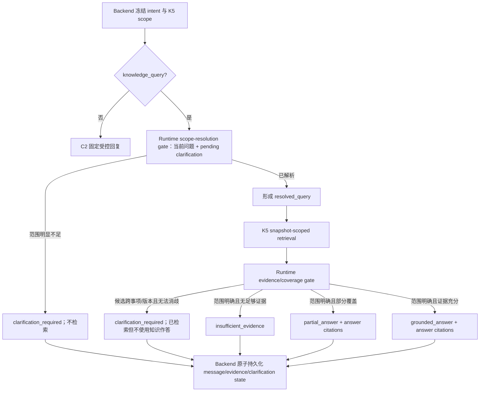

# 单智能体 V1 澄清与有依据回答处置设计

## 文档控制

- 状态：`proposed`（`A1-2` 跨服务契约和持久化、`A1-3` 未发布 Runtime candidate 已完成并验收；`A1-4` 用户状态和质量反馈契约已冻结；均未进入 Q1 或 active release）
- 版本：`v1.5`
- 更新日期：`2026-08-03`
- 工作包：`A1`（Answer disposition）
- 依赖：[有限对话意图路由设计](single-agent-v1-bounded-conversation-intent-design.md)、[K5 快照检索与回答 Provenance 设计](single-agent-v1-k5-snapshot-provenance-design.md)、[C1 回答内证据锚点设计](single-agent-v1-citation-anchors-design.md)、[质量运营与受控发布设计](single-agent-v1-quality-operations-release-design.md)

## 1. 问题与目标

当前 `C2` 入口意图路由正确地把未知、混合和内部业务问题保守地送入 RAG；它不应也不能判断一条内部问题是否已经足够具体。结果是“总结上传知识中最影响一线执行的三条规则”这类请求会检索到不同事项的片段后直接生成答案，既可能遗漏所要求的数量，也可能把跨事项内容误当为同一结论。

本工作包建立一个在 `knowledge_query` 内执行的回答处置（answer disposition）层。目标是：

1. 在缺少必要范围时先追问，而不是用模型或检索结果猜测范围。
2. 在范围明确而证据不足时保持既有拒答边界。
3. 在只满足部分范围时如实说明覆盖度，不凑数量、不暗示完整性。
4. 让用户可分辨“需要补充信息”与“没有知识证据”，让管理员能审计发生过的检索、生成和决策。

非目标：不把普通内部问题改成开放式聊天；不扩展 C2 的 Backend `IntentRouter` 为通用相关性分类器；不在浏览器侧推断答案状态；不以单次用户对话自动改变线上 prompt 或检索阈值。

## 2. 术语与决策矩阵

`intent` 仍由 Backend 在请求入口决定，`knowledge_query` 保持其现有含义：请求应在受限知识范围内处理。`answer_disposition` 是 Runtime 对该知识请求的最终、可持久化处置；它不是新的入口 intent。

| 处置 | 适用条件 | 用户可见行为 | 执行与证据事实 |
| --- | --- | --- | --- |
| `grounded_answer` | 用户问题和既有对话已给出足够范围，证据能支持需要的结论 | 直接回答；每个事实结论有对应 citation/anchor | retrieval=true、generation=true、knowledge_used=true；持久化 snapshot、citation、anchor |
| `clarification_required` | 缺少会改变答案的事项范围、角色/对象、时间/版本、组织实体或排序标准 | 只问一个最小、具体的补充问题；不得先给业务结论 | pre-retrieval 命中时 retrieval=false；post-retrieval 发现证据冲突时 retrieval=true；answer_generation=false、knowledge_used=false；不向用户显示 citation/anchor |
| `insufficient_evidence` | 范围已经明确，但 snapshot 中没有达到证据边界的内容 | 明确说明当前已发布知识无法支持该答案 | retrieval=true、answer_generation=false、refusal=true、knowledge_used=false；不将候选片段显示为答案来源 |
| `partial_answer` | 范围明确，存在可支持的部分事实，但不能满足用户指定的全部数量、比较或覆盖范围 | 列出已证实部分，明确“仅找到 N 项/未覆盖 X”，并邀请补充知识或缩小范围 | retrieval=true、generation=true、knowledge_used=true；每项事实继续带 citation/anchor |

`partial_answer` 不是模糊问题的替代品。若“事项是什么”本身未确定，优先 `clarification_required`；仅当事项与判断口径已确定、而可验证内容不足时才使用 `partial_answer`。

`partial_answer` 的 `supported_count` 只表示“本次回答中有证据支持的结论数量”，不表示知识库只存在这些规则。用户可见文案必须使用“本次检索能够验证 N 项，尚无法验证其余部分”，不能用有限 `top_k` 推断全库基数。若用户要求“最重要”“影响最大”等排序，而知识或用户没有给出排序依据，应先澄清口径，不能由模型自行排名。

示例：

| 用户输入 | 处置 | 预期回复方向 |
| --- | --- | --- |
| “总结上传知识中最影响一线执行的三条规则。” | `clarification_required` | “你希望聚焦哪一类具体事项，例如差旅报销、请假或采购？我会据此总结对应一线规则。” |
| “在差旅报销中，列出员工最需要遵守的三条规则。” | `grounded_answer` 或 `partial_answer` | 只总结差旅报销；若本次仅能验证两条，明确说明尚无法验证第三条。 |
| “差旅报销提交期限是多少？”但 snapshot 没有该规则 | `insufficient_evidence` | 说明当前知识不能确认，不以相近审批规则补齐。 |

## 3. 判定流程与模型边界



判定所需的范围维度只在它们会改变业务结论时检查：

- 事项/主题：如差旅报销、请假、采购，而不是笼统“一线执行”。
- 对象或角色：如员工、直属负责人、财务；当不同角色有不同义务时必需。
- 时间、版本或生效期：规则可能随 revision、地区或时间改变时必需。
- 组织实体或地点：不同部门、法人、地区规则不同时必需。
- 排序或比较口径：如“最重要”“三条”需要已有明确业务范围和判断口径。

范围判定采用两个逻辑关卡：pre-retrieval gate 处理问题文本和待解决澄清中明显缺失的维度；post-retrieval gate 处理只有看到候选后才能发现的跨事项、跨角色或跨版本冲突。两个关卡是产品/架构边界，不预先等同于固定的模型调用次数。`A1-1` 必须比较“一次结构化生成”和“独立 scope resolver + answer generation”的准确率、首片延迟与失败面，再冻结实现；不得仅凭 prompt 直觉决定增加第二次模型调用。

### 3.1 多轮澄清生命周期与查询恢复

Backend/Postgres 是 pending clarification 的唯一状态权威；Runtime 只提出结构化 resolution，Web 不推断用户是否完成澄清。同一 conversation 同一时刻最多有一个 pending clarification：

```text
pending → resolved
        → abandoned
        → expired
```

- `pending`：assistant 已提出澄清问题，记录 original user/message/query、missing dimensions、clarification message 和 `turn_count`。
- `resolved`：后续用户消息补齐范围；Runtime 返回 `resolved_query`，Backend 在同一 exchange transaction 中关联 resolution user message 并关闭 pending 状态。
- `abandoned`：后续输入明显是独立新问题；Backend 关闭旧 pending，按新请求重新判定，不能把新问题硬塞进旧槽位。
- `expired`：连续两次澄清仍未形成可执行范围，或会话策略明确终止该链；系统要求用户用完整问题重新描述，避免无限追问。

Backend 将 pending context 随下一次 Runtime request 发送；Runtime 根据 original query、澄清问题和当前补充生成 `resolved_query`。检索必须使用 `resolved_query`，不能继续只检索“差旅报销”这种片段式回复。原始用户消息永不改写，`resolved_query` 与 clarification identity 只作为 execution evidence 持久化并受 conversation ownership 约束。

模型负责在版本化 policy/prompt 中根据问题、pending clarification、历史与受限证据提出候选处置和文案，但模型输出不是状态权威。Runtime 必须解析受限结构并验证处置不变量，再转换为 API 字段；Backend 再次校验并持久化。这是 prompt engineering 与应用策略共同构成的能力，而不是仅改一段 system prompt。

处置结构缺失、标记非法、超时或 parser 失败属于 `answer_policy_invalid`/既有 retryable Runtime failure，整个 exchange 不得作为成功澄清持久化。只有 scope policy 明确、合法地返回低置信或缺失维度时，才允许输出 `clarification_required`。不得用固定澄清掩盖模型/协议故障，也不得在内部标记尚未解析前把它流给浏览器。

## 4. A1-2 跨服务契约冻结

本节先冻结 `A1-2` 的共享事实，再作为已完成实现的约束。Runtime schema、OpenAPI、Backend domain、Postgres、SSE message projection、Web transport type 与 K7 evidence read model 已按本节实现；这不表示 `A1-3` 的 scope/coverage policy、prompt 或模型调用已上线。

### 4.1 两个独立决策维度

`C3` 的 `context_resolution` 回答“当前消息相对有界历史应如何路由”：`rag`、`controlled_reply` 或 `clarification`，以及 `follow_up`、`standalone`、`topic_shift`、`clarification_required` 等上下文关系。现有公共字段名保持 `context_resolution`，不在 A1-2 改名。它由 `conversation_router_v1` 记录，不能替代 A1 的范围和证据判定。

`A1` 的 `answer_disposition` 回答“这次知识问题最终能以何种证据状态结束”：`grounded_answer`、`partial_answer`、`clarification_required`、`insufficient_evidence` 或 `controlled_response`。它由 conversation-bound `answer_policy_version` 记录。两者必须同时保留，且各自可审计：

| C3 路由 | A1 最终处置 | 允许性和含义 |
| --- | --- | --- |
| `controlled_reply` | `controlled_response` | 仅六种非知识 intent 的冻结模板。无 A1 知识策略、无检索、无业务事实。 |
| `clarification` | `clarification_required` | C3 已知当前指代或主题不足；A1 输出最小缺失维度和问题。不得检索。 |
| `rag` | `grounded_answer`、`partial_answer`、`insufficient_evidence` | 范围可执行后进行 scoped RAG，再按证据覆盖度结束。 |
| `rag` | `clarification_required` | 仅限 post-retrieval 发现跨事项、角色、版本或口径冲突而不能安全消歧；候选只进入管理员 evidence。 |

除表中组合以外的组合都非法。例如 `controlled_reply + grounded_answer`、`clarification + partial_answer`、非 `knowledge_query` 的前三种知识处置必须 fail-closed。C3 的 `clarification` 不等于“已经完成 A1”：它只说明会话参照不足；A1 仍须输出受限的缺失维度和用户问题。反之，C3 `rag` 也不保证最终可回答，A1 可在检索后给出证据不足、部分覆盖或补充问题。

不得为这两个层次恢复任何 phrase router、关键词短路、`controlled_confirmation`、heuristic fallback 或浏览器文本猜测。模型 JSON 不合法、字段关系不合法、provider 失败或任何 Backend 校验失败，都不是“默认澄清”，而是失败的 exchange。

### 4.2 处置字段矩阵与控制回复边界

所有以下字段均为一次 exchange 的事实，而不是 Web 推导出的显示状态。`policy_evaluation_performed` 表示 A1 范围/覆盖策略已实际执行；`answer_generation_performed` 只表示实际生成了用于回答知识事实的最终正文。C3 router 的模型调用由其独立 `router_performed`、provider、model 与 `router_policy_version` 记录，不能借用这两个 A1 字段推断。

| `answer_disposition` | 必须字段与执行事实 | 禁止字段和用户可见边界 |
| --- | --- | --- |
| `grounded_answer` | `intent=knowledge_query`；`answer_policy_version` 非空；`policy_evaluation_performed=true`；`answer_generation_performed=true`；retrieval 已执行；`knowledge_used=true`；scope、`used_citation_ranks`、对应 answer citations 与 anchors 均非空。 | 无 `clarification`、无 `coverage`；每个业务事实必须由 anchor 指向所用 rank。 |
| `partial_answer` | 满足 `grounded_answer` 的执行和引用要求；`coverage` 必填，且 `requested_count >= 1`、`0 <= supported_count < requested_count`，并有非空 `uncovered_description`。 | 无 `clarification`；覆盖说明不得被写成“知识库只有这些内容”，也不得伪装为受证据支持的业务事实。 |
| `clarification_required` | `intent=knowledge_query`；`answer_policy_version` 非空；`policy_evaluation_performed=true`；`answer_generation_performed=false`；`knowledge_used=false`；`clarification` 必填。pre-retrieval 时 retrieval 未执行；post-retrieval 时允许已执行。 | `coverage`、answer citations、anchors、`used_citation_ranks` 和普通用户来源入口均为空；不得先输出业务结论。 |
| `insufficient_evidence` | `intent=knowledge_query`；`answer_policy_version` 非空；`policy_evaluation_performed=true`；retrieval 已执行；`answer_generation_performed=false`；`knowledge_used=false`；`refusal=true`。 | `clarification`、`coverage`、answer citations、anchors、`used_citation_ranks` 均为空；不得以相近候选补齐答案。 |
| `controlled_response` | 仅 `C3 controlled_reply` 的非知识 intent；`policy_evaluation_performed=false`；`answer_generation_performed=false`；retrieval 未执行；`knowledge_used=false`；文本来自冻结模板。 | 不带 `answer_policy_version`、`clarification`、`coverage`、retrieval candidates、answer citations、anchors 或 ranks；不得包含业务型自由生成内容。 |

兼容字段 `generation_performed` 在 A1 新记录中只镜像 `answer_generation_performed`；不得再用它判断 router 或 answer-policy 是否调用过模型。`execution_observation` 必须分别记录 router、answer policy、retrieval 与 answer generation 的 `performed/not_run`、实际 provider/model（实际调用时）和全局 `fallback_used=false`。无 provider 或 `fallback_used=true` 的成功回答记录均非法；产品路径不允许 heuristic fallback。

`clarification` 是 Runtime 提出的 `{missing_dimensions, question}`，其中 `missing_dimensions` 非空且去重，`question` 为一个最小的补充问题。Runtime 不能创建 clarification ID。Backend 在事务内生成权威 `clarification_id`，并只在持久化后的消息/API 投影中返回它。`coverage` 只属于 `partial_answer`。`resolved_query` 与 `resolution` 只供受控检索、状态转换和管理员 evidence 使用，不能覆盖或改写原始用户消息。

### 4.3 Request、response、消息与 evidence 数据流

对 `knowledge_query`，Backend 在调用 Runtime 前冻结 conversation owner、最多六条有 ID 的历史、conversation-bound AgentConfig、K5 active scope 和可选 pending clarification。C3 首先给出已验证的 `conversation_resolution`；A1 再在合法路由内给出最终处置。Runtime 不读写数据库、不分配 state ID、不改变权限、不选择 active snapshot。

`ChatRuntimeRequest` 的 A1 新字段为：

```json
{
  "answer_policy_version": "answer_policy_v1",
  "pending_clarification": {
    "clarification_id": "clrf_...",
    "state_version": 3,
    "original_user_message_id": "msg_...",
    "original_query": "总结上传知识中最影响一线执行的三条规则",
    "missing_dimensions": ["business_subject"],
    "question": "你希望聚焦哪类具体事项？",
    "turn_count": 1
  }
}
```

- `answer_policy_version` 必须等于该 conversation 绑定的不可变 AgentConfig 值；Runtime 不接受未知版本，也不能自行替换版本。普通对话在 C3 解析前的入口 intent 为 `context_routing_required`，因此该字段允许随 `context_routing_required` 请求传入；Runtime 只有在最终 `knowledge_query` 路由中才执行 A1。
- `pending_clarification` 仅由 Backend 从当前 `pending` 行构造；没有 pending 时字段缺席。它不是历史文本的替代品，也不能由 Web 传入。为允许 C3 把“用户补充”与独立新问题区分开，它同样允许随 `context_routing_required` 请求传入；最终非知识 `controlled_reply` 不得保留或消费该状态。
- 对 `knowledge_query`，K5 scope 仍是必需前置条件。不存在 active snapshot 或 scope 不能冻结时 fail-closed；不能借 pre-retrieval clarification 绕过 scope/ownership 边界。非知识 `controlled_reply` 沿用 C3 的无 scope 路径。

`ChatRuntimeResponse` 与 Backend 内存对象必须为 `answer_disposition`、`answer_policy_version`、`policy_evaluation_performed`、`answer_generation_performed`、`clarification`、`coverage`、`resolution`、`resolved_query`、`retrieval_candidates`、`used_citation_ranks`、answer citations、anchors 和完整 execution observation 定义 schema slot，并按处置矩阵决定必填或缺席。Backend 对外 JSON/SSE `message.completed` 只投影普通用户允许读取的字段，绝不透传 `resolution`、`resolved_query` 或 `retrieval_candidates`。字段分层如下：

| 字段 | 产生者 | 持久化位置 | 普通用户接口 | 管理员 evidence |
| --- | --- | --- | --- |
| `conversation_resolution`（含 `router_policy_version`） | Runtime 输出语义，Backend 校验并补写代码版本 | execution evidence | 不显示 `resolved_query`、basis IDs 或 provider | 显示受控诊断 |
| `answer_disposition`、`answer_policy_version`、两个 A1 performed 字段 | Runtime 输出，Backend 与 AgentConfig/执行事实校验 | assistant message 投影 + execution evidence | 可显示处置；不得从正文反推 | 显示 |
| `clarification` | Runtime 提议，Backend 绑定新/续 pending | clarification 行 + execution evidence | 显示问题，不显示 sources | 显示 |
| `resolution`、`resolved_query` | Runtime 提议，Backend 以 state 条件提交 | clarification 行 + execution evidence | 不显示 | 显示 |
| `coverage` | Runtime 输出，Backend 校验 `partial_answer` 关系 | assistant message 投影 + execution evidence | 显示覆盖说明 | 显示 |
| `retrieval_candidates` | Runtime retrieval 输出 | 管理员诊断 evidence | 不显示 | 显示受控元数据 |
| answer citations、anchors、`used_citation_ranks` | Runtime 选择，Backend 校验 | 既有用户 citation/anchor 表 + execution evidence | 显示 | 显示 |

`resolution` 的冻结形状为：

```json
{
  "pending_clarification_id": "clrf_...",
  "pending_state_version": 3,
  "action": "resolved | abandoned | needs_more",
  "resolved_query": "差旅报销中一线员工需要遵守的三条规则"
}
```

它只允许在 request 含有同一 `pending_clarification` 时出现。`resolved` 必须有非空 `resolved_query`；`abandoned` 和 `needs_more` 不得携带它。`needs_more` 仍是同一 pending 的一次受控更新；`expired` 是 Backend 根据已冻结的连续澄清上限作出的终态，不是 Runtime 可伪造的 action。没有 pending 时，C3 follow-up 的 `conversation_resolution.resolved_query` 仍可仅用于本次 RAG，不能冒充 A1 pending resolution。

### 4.4 Postgres 状态权威与原子写入

Backend/Postgres 是 pending clarification 的唯一状态权威。`conversation_clarifications` 至少保存 `clarification_id`、conversation ID、original user message ID 和原始 query、创建它的 assistant message ID、missing dimensions、question、status、`state_version`、turn count、resolution user message ID、resolved query、终态原因与时间。数据库约束保证每个 conversation 同一时刻最多一条 `pending`。

一个成功 exchange 的单一事务必须写入 user message、assistant message、K5 snapshot/provenance（若 retrieval 已执行）、A1 message/evidence 字段、retrieval candidates、用户可见 answer citations/anchors，以及以下一个 clarification 转换：

| 输入 pending 与 Runtime `resolution` | Backend 条件写入 | 结果 |
| --- | --- | --- |
| 无 pending，`clarification_required` | 创建新行 | 新行 `pending`、`state_version=1`，关联当前 assistant message。 |
| pending，`resolved` | `WHERE clarification_id=? AND state='pending' AND state_version=?` | 原行变为 `resolved`，记录当前用户 resolution message 与 `resolved_query`。 |
| pending，`abandoned` | 同一 ID/version 条件 | 原行变为 `abandoned`；当前消息按新的独立问题处理，若再次澄清则创建另一新行。 |
| pending，`needs_more` | 同一 ID/version 条件 | 原行保持 `pending`，更新缺失维度/问题、递增 turn count 与 `state_version`；若上限已到则 Backend 写为 `expired`。 |

任一条件写入影响行数不是 `1`，或唯一 pending 约束冲突时，Backend 以 retryable `clarification_state_conflict` 失败整个 exchange；不得把 Runtime 的 `resolution` 静默应用到较新的 pending，也不得写入部分 message/citation/evidence。原始用户消息永久保持原文；`resolved_query` 是 evidence/retrieval 派生值，绝不回填、替换或修改该消息。

历史记录只使用 `legacy_unknown` 或空值；迁移仅新增可追加字段/表和兼容读取，不扫描回填、不改写历史正文、不把历史 C3 或 citation 数据臆断为 A1 disposition。只有读路径在既有 evidence 无歧义时可以标明“derived for display”，且不得写回数据库。

### 4.5 Retrieval candidates 与 answer citations

`retrieval_candidates` 与 answer citations 是两类不同对象。前者是 Runtime 为 policy/retrieval 得到的诊断集合，后者才是对用户正文中业务事实的证明。

- 每个 candidate 至少有 chunk/document/revision identity、content hash、retrieval rank、score 和 source locator。Postgres 只为管理员 evidence 保存这些受控元数据，不无界复制私有 chunk 正文；普通用户 JSON、SSE、消息来源接口和 Web 均不可读取它。
- Runtime 的 `used_citation_ranks` 必须是 candidate rank 的非空、去重子集。Backend 逐项验证 identity、scope/revision、rank 和 anchor 引用关系；anchor 只能引用该集合。
- Backend 只将 `used_citation_ranks` 指向的 candidate 写入既有用户可见 citations/anchors。`clarification_required` 和 `insufficient_evidence` 可以有 candidates，但永远没有 answer citation、anchor 或用户来源入口。
- `grounded_answer` 与 `partial_answer` 的 message-level sources、计数和 Web 详情抽屉只来自 answer citations。Web 不得从正文、候选数或相似度重新猜测来源；无 anchor 的历史消息继续按 legacy 兼容路径展示。

### 4.6 Fail-closed 与工作包边界

本冻结只定义数据对象、允许组合、写入条件和兼容读取边界。Runtime 的 pre/post retrieval policy、prompt、结构化输出 parser、模型调用次数及 coverage 判定算法属于 `A1-3`；本任务不实现或挑选它们。普通用户/管理员的状态文案、来源入口、反馈控件和浏览器验收属于 `A1-4`；本任务不改变界面。冻结集上的真实模型比较、阈值、Q1 approval/publish 与持续数据治理属于 `A1-5`；本任务不发布任何配置。

无论后续实现采用一次还是两次模型调用，A1-2 的 fail-closed 契约不变：未知 `answer_policy_version`、无效 disposition 组合、非法 `resolution`、pending ID/version 不匹配、候选与 scope 不匹配、rank/anchor 不一致、缺失必要 provider observation、`fallback_used=true`、JSON/parser/provider 失败都必须使 exchange 失败，不能用固定文案、短语规则、heuristic fallback、伪回答或伪引用补救。失败只按既有执行失败路径记录，不写入成功 message、clarification state、用户 citation 或 anchor。

### 4.7 A1-2 交付证据（2026-08-02）

- 共享 Runtime JSON schema、Pydantic、OpenAPI、Go domain 和 Web transport types 已同步 `answer_policy_version`、pending clarification、五种 disposition、coverage/resolution、retrieval candidates、selected citation ranks 与 execution observation。普通用户 message/SSE 只保留允许显示的 message projection；resolution、resolved query 与 candidates 仅在管理员 evidence 保留。
- Postgres migration `024_a1_clarification_evidence_contract` 以可追加字段和表保存 policy、message projection、evidence 和 candidate metadata；历史记录保持 `legacy_unknown` 或空值，没有回填或正文改写。
- `PostgresStore` 是唯一 pending writer：锁定当前行并以 ID/state version 条件写入，在同一个事务内完成 user/assistant message、evidence、citation/anchor、candidate 和 `pending -> resolved|abandoned|expired`。冲突会回滚整个 exchange。
- Runtime/Backend contract regression、隔离 Postgres lifecycle smoke、Web type/lint 与 JSON/OpenAPI parse 均已通过。`A1-3` 的 policy/prompt candidate 与真实模型 probe 已在第 4.9 节记录；用户状态文案、来源入口、反馈控件和浏览器 presentation 仍属于 `A1-4`。

### 4.8 A1-3 候选 Runtime policy 设计冻结（2026-08-02）

`A1-3` 只创建 immutable 候选 `prompt_v8 + answer_policy_v1`，不修改当前 active quality release、既有 conversation binding 或 `prompt_v7`。Backend 仅在 conversation-bound AgentConfig 的 `answer_policy_version=answer_policy_v1` 时发送该字段；旧 config 保持既有路径和 `legacy_unknown` 兼容读取。

候选 normal turn 的执行顺序固定如下：

```text
C3 router (仅 context_routing_required)
  -> controlled_reply: 固定回复，A1 policy not_run，pending 不消费
  -> knowledge_query: scope policy JSON
       -> clarification_required: 无检索、无 answer generation
       -> retrieve: scoped retrieval
            -> no evidence: insufficient_evidence
            -> answer policy/generation JSON: grounded | partial | post-retrieval clarification | insufficient
```

1. **C3 保持独立。** C3 `controlled_reply` 直接返回既有冻结模板，response 不带 A1 policy/resolution；若 request 带 pending clarification，Backend 不改变该 pending，使用户在下一条业务消息仍可继续原澄清。C3 `clarification` 只说明会话参照不足，必须继续调用 A1 scope policy 产出最小 `clarification`，不得返回固定通用澄清文案。
2. **scope policy 是第一道模型 JSON gate。** 输入只包括当前 query、最多六条有 ID 历史、C3 resolution 和 Backend 权威 pending；输出是严格 JSON 的 `retrieve | clarification_required`、可选最小 clarification，以及 pending 的 `resolved | abandoned | needs_more` 关系。Runtime 在 provider 支持时发送由同一 Pydantic 契约导出的 JSON Schema；没有 pending 时该 schema 将 `pending_action` 和 `resolved_query` 收紧为 `null`。这只是约束模型的输出空间，Pydantic parser 与后续 request-aware 校验仍是唯一裁决，不能把 schema 拒绝改成 fallback。scope policy 不会写数据库、不会生成用户正文、不会检索；无法解析、字段不合法、ID/version 不匹配或 provider 失败一律为 `answer_policy_invalid`。
3. **检索只使用受控 query。** 无 pending 使用当前 query；pending `resolved` 候选使用 scope policy 给出的内部 resolved query。最终成功 answer 才将同一 query 作为 `resolution.resolved_query` 持久化。若 post-retrieval 又需补充范围，Runtime 返回 `needs_more`（或独立问题的 `abandoned`）而非假装 resolved；内部检索 query 不被当成用户事实或回填原消息。
4. **answer policy/generation 是第二道受限 JSON gate。** 它只读取 immutable scope 的 retrieval candidates/context，并输出 `grounded_answer`、`partial_answer`、`clarification_required` 或 `insufficient_evidence`、可选 coverage/clarification 和正文。正文仍使用现有 citation marker parser；只有 JSON、disposition、coverage、candidate identity 和 anchor/rank 全部通过后才成为用户正文。模型不能输出 provider、snapshot、pending ID/version、candidate identity 或任意持久化 ID。
5. **streaming 先缓冲后释放。** 两个 JSON protocol 和 citation markers 都不得在 `message.delta` 中泄漏。A1 policy 失败在第一条 delta 前返回 `message.error(code=answer_policy_invalid)`；成功时才按既有分块发送已验证正文，随后发送同一 `ChatResponse` 的 completed event。没有“边流边猜策略”的 fallback。
6. **执行证据补充 policy 调用事实。** `ExecutionObservation` 兼容性新增 `policy_provider`、`policy_model_id` 和 `policy_call_count`。A1 knowledge success 必须有 `policy=performed`、非空 provider/model 与 call count；pre-retrieval clarification 为 `1`，发生 post-retrieval policy 的路径为 `2`。`generation` 仍只表示生成可作为知识答案的正文，不能把澄清 JSON 误记为 answer generation。controlled response 保持 `policy=not_run` 且无 policy provider/model/count。
7. **Backend 仍是状态与引用的裁决者。** Runtime 只能提出 resolution；Backend 按 pending ID/state version 条件事务写入。只有 `used_citation_ranks` 的 candidate 子集才能成为用户 citation/anchor；clarification 和 insufficient evidence 的 candidates 只进管理员 evidence。Runtime 的任何 JSON/marker/provider 异常都不会写成功 message、pending、citation 或 anchor。

禁止将 scope decision、coverage 数量、缺失维度、独立问题判断或 citation rank 改为 phrase router、关键词规则、浏览器推断或“默认澄清”。候选策略的模型调用次数固定为 scope policy 一次，必要时 post-retrieval policy 一次；真实延迟、准确率和 provider evidence 由 A1-5/Q1 决定是否发布，而不是由代码路径自动启用。

### 4.9 A1-3 实施与候选证据（2026-08-02）

- Runtime 已实现 `prompt_v8 + answer_policy_v1` 的两阶段路径、零未验证 delta、scope/answer JSON parser、citation rank/anchor 验证和 execution policy evidence；Backend 复核 policy provider/model/call count、候选与用户 citation 分层和受限事务写入。C3 controlled reply 仍保持 `policy=not_run`。
- 对没有 pending clarification 的 scope policy，Runtime 向 `ollama_native` 发送由 `ScopePolicyDecision` 导出的 JSON Schema，并将 `pending_action`、`resolved_query` 限定为 `null`。这避免模型重述当前问题为 resolved query；严格 parser 与 request-aware 校验没有放宽，其他 provider 仍以其既有 JSON mode 加 parser fail-closed。
- 自动化证据：`make runtime-test` 为 `154 passed`；Backend `go test ./...`、Web `pnpm typecheck`/`pnpm lint`、JSON/OpenAPI parse 和 fullstack readiness smoke 均通过。测试覆盖 pre/post retrieval clarification、pending resolved、C3 controlled reply、非法 JSON/未知 citation rank 零 delta、no-pending resolved-query 拒绝与 native schema transport。
- 真实本机候选 probe 固定 `snap_004`、`sha256:b537...12f6`、`rev_0e89b60db82f963ac810`、`native_dense_v1`、`qwen3:14b` 和 `qwen3-embedding:0.6b`：初始 scope 输出多填 `resolved_query`，被 `answer_policy_invalid` 拒绝；加入 schema 约束后，JSON `/v1/chat/run` 与 SSE 均返回 `grounded_answer`、rank `1,2` anchors、`policy_provider=ollama_native`、`policy_model_id=qwen3:14b`、`policy_call_count=2`、`fallback_used=false`。没有创建或发布 active AgentConfig。
- 真实 Backend SSE 还验证了当前 active `prompt_v7` 的受控 greeting 与 snapshot-scoped RAG 答案，以及 Runtime 停止时的 `runtime_unavailable` error。`2026-08-03` 的 Codex In-app Browser 验收已完成：普通用户登录后，`conv_031` 的差旅期限问题显示带 evidence anchor 的答案与“查看 1 条已引用来源”；来源抽屉显示同一 `snap_004`、revision、chunk hash 和原文片段。停止 Runtime 后，下一条业务问题显示“Runtime 暂不可用，本次消息没有被伪装成成功回复。”、未完成消息和“重试上一条”；恢复 Runtime 后，页面重试返回带引用的答案。该浏览器验收验证的是当前 active `prompt_v7` 的用户交互，未把未发布候选伪装成 active release。

## 5. 引用与 Web 行为

现有“检索候选”和“用户看到的引用”被同一 `citations_count` 混用，导致 `conv_047` 中正文只锚定两项规则、UI 却显示“查看 3 条来源”。本工作包把两者分层；其正式持久化与读取契约已在第 4.5 节冻结：

- **retrieval candidates**：Runtime 为决策得到的候选，仅供受控 execution evidence / 管理员诊断，不是对用户答案的证明。持久化以 chunk/document/revision identity、score、content hash 和 retrieval rank 为主，避免无界重复保存完整私有片段。
- **answer citations**：Runtime 通过 `used_citation_ranks` 明确选出的、实际支持答案事实的来源；Backend 验证并持久化，消息级入口、引用数、anchor hover 与详情抽屉只使用这一集合。

在完整的数据模型切片完成前，Web 的立即兼容修正可先从 `citation_anchors` 的 rank 并集计算“已引用来源”并过滤抽屉；没有 anchor 的旧回答仍保留现有消息级来源入口。该修正不得由前端猜测 citation 是否真正支持文本。

### 5.1 A1-4 用户状态和来源入口

普通用户只读取 Backend 持久化的 completed assistant message 中的 `answer_disposition`、`coverage`、citation/anchor 和既有消息状态；不得从正文、候选数量、检索结果、snapshot 或浏览器本地状态推断处置。缺少 `answer_disposition` 的 legacy message 保持现有展示，不能被投影成任何 A1 结果。

| 已持久化处置 | 聊天卡片 | 来源、知识版本与核验入口 |
| --- | --- | --- |
| `grounded_answer` | 保持普通有依据回答外观。 | 只显示实际 answer citations/anchors。 |
| `partial_answer` | 显示“已覆盖部分”，并从结构化 `coverage` 显示“本次已验证 N/M 项”和未覆盖描述；正文不能替代该结构化提示。 | 只显示实际 answer citations/anchors；不从 retrieval candidates 补来源。 |
| `clarification_required` | 显示“需要补充范围”和 Runtime 已校验的最小问题，用户可在同一会话直接补充。 | 不显示来源、回答知识版本、freshness 或历史核验；不得请求来源接口。 |
| `insufficient_evidence` | 显示“当前知识不足”和受控不足说明。 | 不显示来源、回答知识版本、freshness 或历史核验；不得把候选显示为引用。 |
| `controlled_response` | 保持 C2 的受控非知识回复展示。 | 不显示知识状态、来源或核验。 |

来源入口是防御性双重门：Web 仅为 `grounded_answer`、`partial_answer` 或无 A1 处置的兼容历史消息显示已有 citation 入口；Backend 的 message source read path 仍只读取 answer citations，永不读取 retrieval candidates。即使非法或历史 payload 带有非零 `citations_count`，`clarification_required`、`insufficient_evidence` 和 `controlled_response` 也不得在普通用户界面触发来源读取。SSE `message.completed` 与刷新后的 conversation detail 必须得出相同视图；streaming/pending/failed 卡片继续沿用 U2 状态，不能显示 A1 完成处置。

### 5.2 A1-4 管理员证据与质量反馈

`/config` 的系统管理员 evidence 详情必须把“是否检索”“是否将知识用于事实回答”和“最终为何不能完整回答”分开显示：

- 显示 `answer_disposition`、policy/generation/retrieval 的实际 performed 事实和 `knowledge_used`；`retrieval_performed=true` 不得被文案简化为“已基于知识回答”。
- `clarification_required` 显示 `missing_dimensions`、澄清问题和可用的 pending resolution；`insufficient_evidence` 显示范围已明确但没有足够证据这一处置，并可显示受控 retrieval candidate 元数据，不能把候选标作 citation。
- `partial_answer` 显示 `coverage` 的 requested/supported count 与未覆盖描述；`grounded_answer` 无 coverage 时显示完整有依据处置。answer citations、used ranks 与 retrieval candidates 保持三层分开。

AnswerFeedback 继续是 Postgres/Backend 管理的 append-only 记录，绝不修改消息、citation、snapshot、provenance、prompt 或线上配置。除既有七种反馈外，新增以下只面向具有当前 A1 evidence 的知识 assistant message 的分类：

| kind | 可锚定的实际处置 | 必填/禁止输入 | 含义 |
| --- | --- | --- | --- |
| `should_clarify` | `grounded_answer`、`partial_answer`、`insufficient_evidence` | 非空 `comment`；禁止 `expected_citation_ranks` | 该请求缺少会改变答案的范围，本应先问最小澄清问题。 |
| `unnecessary_clarification` | `clarification_required` | 非空 `comment`；禁止 `expected_citation_ranks` | 已有问题与会话上下文足以回答，不应额外澄清。 |
| `incomplete_coverage` | `grounded_answer`、`partial_answer` | 非空 `comment`；禁止 `expected_citation_ranks` | 已回答的范围或声明的完整性遗漏了应覆盖的点；它不评价 citation 是否支持已回答事实。 |
| `wrong_evidence` | 沿用既有契约 | 沿用既有 comment/corrected answer/rank 校验 | 复用为“用户可见引用不支持已回答事实”的反馈，不新建重叠枚举。 |

新三类反馈要求 target message 同时具有 `intent=knowledge_query`、非空 `answer_disposition` 和 execution evidence；legacy、`controlled_response`、非知识或 failed message 一律拒绝。现有 feedback kind 的历史写入和读取保持兼容。所有 kind 仍需 system-admin 身份、幂等键、assistant message 与 execution evidence；rank（若允许）必须属于该 message 的 answer citation。Postgres migration 只能替换 `answer_feedback.kind` 的检查约束以加入新值，不能回写历史 feedback 或 message。

Web 根据所选 evidence 的实际处置过滤反馈类型，并在切换到语义反馈时清空 citation rank 输入；这只是减少无效请求，Backend 是上述 target/disposition/comment/rank 不变量的唯一裁决。管理员界面不能通过 URL、Next.js proxy 或前端 state 绕过 Backend role gate 或验证。

## 6. 失败、回滚与安全边界

- C2 高置信问候/开放世界拒答保持既有固定路径，不能被本设计改成 Runtime 澄清。
- 无 active snapshot 的 `knowledge_query` 继续 fail-closed 为 `knowledge_snapshot_unavailable`；pre-retrieval 澄清可以不执行检索，但 Backend 仍须先取得并冻结 K5 request scope，不能借澄清绕过知识运行边界。
- Runtime response 的处置、citation、anchor、knowledge_used 或 snapshot 事实相互矛盾时，Backend 拒绝持久化整个 exchange。
- 处置解析失败、模型超时、输出受禁业务断言或未知 policy version 时必须返回稳定 retryable failure；不得伪装为正常澄清，也不得静默降级为自由生成答案。
- 质量评测和全栈验收必须从 Runtime observation 证明实际 provider 且 `fallback_used=false`。产品 Runtime 已删除 heuristic generation fallback；历史 fallback 报告不得登记为真实模型质量或进入 Q1 发布许可。
- 回滚采用新 AgentConfig/prompt version 和可追加 migration 的兼容读取；停止发布候选配置即可令新 conversation 回到上一质量 release，历史 conversation 保持原 binding。

## 7. 验收矩阵

- “总结上传知识中最影响一线执行的三条规则”在空上下文中为 `clarification_required`，不输出报销、请假等具体规则、citation 或 anchor。
- 已说明“差旅报销”的连续下一轮可从 history 恢复范围并回答；不会重复询问同一维度。
- 用户回复“差旅报销”时生成可审计的 `resolved_query` 并用于 retrieval；若用户改问独立新问题，旧 clarification 变为 `abandoned`，不能错误拼接。
- “在差旅报销中列三条规则”若本次只支持两项，输出 `partial_answer`，事实有 citation/anchor，且表述为“本次能够验证两项”，不声称知识库只有两项。
- 明确主题但无证据为 `insufficient_evidence`，不以相近领域或候选片段补齐。
- 明确且可支持的问题仍为 `grounded_answer`，现有 C1/K5/K6 citation 与 snapshot 契约不退化。
- legacy message 为 `legacy_unknown`/空值，不被错误投影成 grounded answer。
- policy marker 解析失败产生 retryable error 且不持久化成功 exchange；stream 中不泄漏内部 marker。
- JSON 与 SSE、memory/Postgres、普通用户 UI/管理员 evidence 对四种处置一致；真实 provider/fallback observation 可追溯；C2、知识演进 fixture、onboarding、严格 quality gate 和浏览器失败路径均通过。
