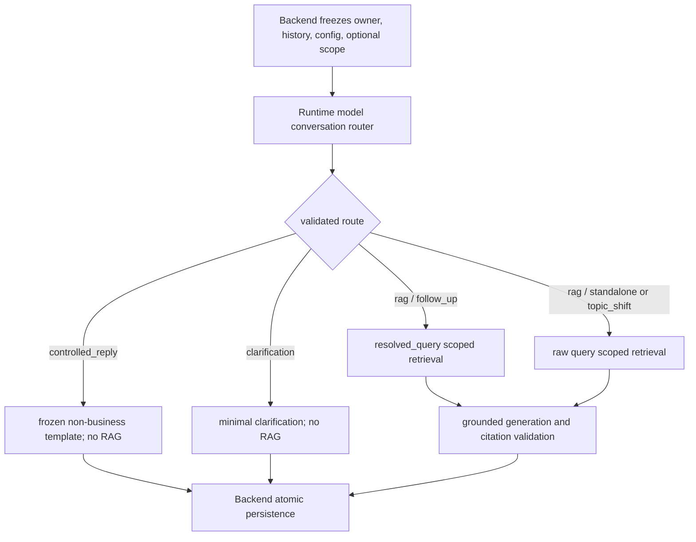

# 单智能体 V1 会话上下文路由设计

## 文档控制

- 状态：`verified`
- 版本：`v2.0`
- 更新日期：`2026-07-30`
- 工作包：`C3-R2`（Unified Conversation Routing）
- 取代：`C3-R1` 的 Backend `controlled_confirmation`、固定确认短语与“只对候选短句调用 resolver”的行为。历史消息/evidence 仍只读，不回填。

## 1. 决策

- **Change**：每条普通聊天消息先由 Runtime 模型基于有界历史输出结构化 `conversation_resolution`，再决定 `rag`、`controlled_reply` 或 `clarification`。
- **Contract / boundary**：Backend 只发送 `intent=context_routing_required`，不再使用关键词决定普通聊天的语义 intent；Runtime 返回实际 intent、route 与 context relation。`user_query` 不可变，`resolved_query` 仅可用于本次 RAG。
- **Owner / write path**：Backend 是 history ownership、active-scope lookup、Runtime output validation、user/assistant/evidence transaction 的唯一 writer。Runtime 不读数据库、不写数据库、不改变权限或 snapshot。
- **Consistency**：一个 exchange 只接受一个 validated route；RAG route 的 scope、resolved query、retrieval、citation 与回答在同一 Backend persistence transaction 中一致。direct route 不写 snapshot/citation；clarification 不检索。
- **Failure**：router JSON、route 不变量、scope 或 provider 失败均 fail closed；不得退回 Backend 关键词、全历史拼接检索或无引用业务回答。
- **Rejected**：不保留 `controlled_confirmation` 作为性能快捷路径；不让模型自由生成业务型 direct answer；不引入长期记忆、工具、多 Agent 或框架迁移。

## 2. 用户可见处置

| route | 模型解析的 intent | 执行 | 用户可见行为 |
| --- | --- | --- | --- |
| `rag` | `knowledge_query` | 以 validated `resolved_query`（follow-up）或原始 query（standalone/topic shift）做 snapshot-scoped retrieval，再生成带 citation 的答案 | 正常回答、部分回答或证据不足。 |
| `controlled_reply` | `social_greeting`、`social_thanks`、`social_farewell`、`capability_help`、`off_topic`、`out_of_scope` | 不检索、不生成业务答案；Runtime 从冻结 template 选择简短回复 | 正常问候/说明范围/拒绝开放世界问题，无 citation。 |
| `clarification` | `knowledge_query` | 不检索、不生成业务答案 | 询问最小必要范围。 |

模型可以理解“真的吗？”与前一条能力说明的关系，但它不返回 `controlled_confirmation`。应将其解析为 `capability_help + controlled_reply`，从而得到普通能力范围说明；不存在 Backend 对“真的吗 / 是吗 / 确定吗”的特例。

## 3. 跨服务契约

### 3.1 Request

普通聊天请求使用 `intent=context_routing_required`。Backend 冻结：

- 当前 authenticated owner 的最近最多 6 条非空 `user/assistant` 历史，每项有不可变 `message_id`；总字符数有限。
- conversation-bound model/config 与可能存在的 active knowledge scope。Backend 读取 scope 失败（依赖故障）仍失败；仅“没有 active snapshot”不应阻止模型回复问候，但 RAG route 必须随后返回 `knowledge_snapshot_unavailable`。
- `user_query` 原文；不得把历史或改写结果覆盖它。

历史 `controlled_confirmation` response/evidence 允许只读；新 request/response enum 不再生产该值。

### 3.2 Model resolution

Runtime 必须使用本次 conversation-bound model、低温、短输出与 provider JSON mode。其输入仅为历史与当前原文；输出严格为：

```json
{
  "intent": "knowledge_query | social_greeting | social_thanks | social_farewell | capability_help | off_topic | out_of_scope",
  "route": "rag | controlled_reply | clarification",
  "context_kind": "follow_up | standalone | topic_shift | clarification_required",
  "resolved_query": "only for rag + follow_up",
  "basis_message_ids": ["msg_..."],
  "confidence": 0.0
}
```

Invariants:

- `rag` requires `intent=knowledge_query`. `follow_up` requires `confidence >= 0.9`, nonempty `resolved_query` and 1–6 unique basis IDs from the sent history.
- `rag + standalone/topic_shift` must have null `resolved_query` and no basis IDs. topic shift must use the raw current query.
- `clarification` requires `intent=knowledge_query`, `context_kind=clarification_required`, no resolved query/basis IDs and no retrieval.
- `controlled_reply` requires one of the six non-knowledge intents, `context_kind=standalone`, no resolved query/basis IDs and no retrieval. Its text comes only from frozen templates, never model-supplied business prose.
- Model output with an unknown field/value, non-numeric confidence, invalid combination, forged basis ID, JSON failure or timeout is `conversation_routing_failed`; no success message/citation is written.

### 3.3 Response and evidence

`context_resolution` is renamed semantically to `conversation_resolution` in public/shared contracts. It records `intent`、`route`、`context_kind`、`resolved_query`（管理员 evidence only）、basis IDs、router provider/model、Backend-owned `router_policy_version=conversation_router_v1` and `router_performed=true`.

The current Postgres JSONB column may remain named `context_resolution` for append-only compatibility, but its v2 payload must carry `router_policy_version=conversation_router_v1` when the router was performed; no migration rewrites historic v1 payloads. Backend stamps this code-owned policy after validating Runtime route facts and before persistence. Runtime/model output does not own this release identifier. Backend rejects response/evidence whose route execution facts disagree with the validated resolution.

## 4. Execution flow



The model decides semantic route, not authorization. Backend validates ownership/history, permits only the frozen direct routes, enforces scope for `rag`, validates citations and persists the facts. Thus a business query misclassified as non-business can at most receive a bounded non-business template, never an unsupported business answer; a correctly classified business query cannot bypass RAG.

## 5. Migration and rollback

- Remove `controlled_confirmation` from new Runtime request/response strict schemas, Go/Python intent types, Backend router and Runtime controlled-response map. Do not delete historical messages/evidence.
- Add request-only `context_routing_required`; response never returns it. Update OpenAPI, JSON schemas, DTOs, SSE and Web union types together.
- Version the router as `conversation_router_v1` in execution evidence. This code-owned policy is not admin-editable in this slice; a future Q1 candidate must bind and evaluate it explicitly. Q1/router reports must record `router_policy_version=conversation_router_v1` as a frozen condition beside model, prompt, retrieval strategy, dataset hash and scope.
- Rollback is a forward code/config release to the prior supported router policy. It must not re-enable the C3-R1 phrase list or silently classify every request as `knowledge_query`.

## 6. Acceptance matrix

1. `你好` → model `social_greeting/controlled_reply`; no scope requirement, retrieval, generation or citation.
2. `你好 → 真的吗？` → model `capability_help/controlled_reply`; no `controlled_confirmation` request or response value.
3. `差旅报销提交期限？` → `knowledge_query/rag/standalone`; scoped RAG with citation.
4. `差旅报销提交期限？ → 超过期限呢？` → `knowledge_query/rag/follow_up`; resolved query contains the travel-expense subject and basis IDs are valid.
5. `差旅… → 那请假如何申请？` → `knowledge_query/rag/topic_shift`; raw leave query, no historic travel injection.
6. `那个怎么办？` without uniquely recoverable subject → `knowledge_query/clarification/clarification_required`; no retrieval/citation.
7. Public weather/president, thanks and farewell follow `controlled_reply`; mixed/internal questions remain RAG.
8. Invalid JSON, illegal route pair, missing RAG scope, forged basis IDs and provider timeout fail closed; only a failed attempt is recorded.
9. JSON/SSE/memory/Postgres/admin evidence agree. Backend/Runtime full tests, Web/browser, A1 fixtures and real Qwen multi-turn evaluation pass.
