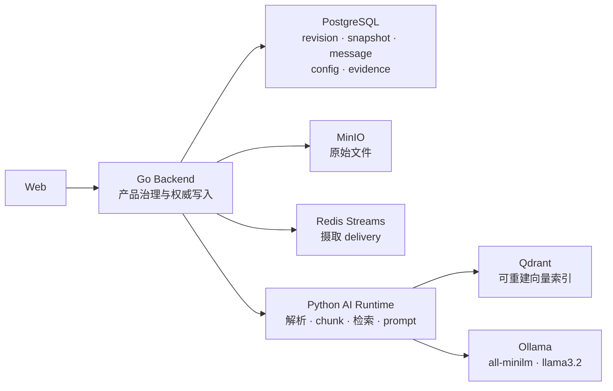

# 单智能体 V1 摄取、检索与回答职责导读

## 文档控制

- 状态：`active`
- 版本：`v1.0`
- 更新日期：`2026-07-16`
- 目的：为后续学习与排障说明“上传知识”和“用户提问”两条端到端链路的服务分工、权威边界、版本语义与失败处理。
- 定位：本文是架构导读，不替代领域状态机或 API 契约。revision/snapshot 以 [知识演进设计](single-agent-v1-knowledge-evolution-design.md) 为准，消息 scope/provenance 以 [K5 设计](single-agent-v1-k5-snapshot-provenance-design.md) 为准，native dense 以 [K8-R1 设计](single-agent-v1-k8-native-retrieval-design.md) 为准。

## 1. 先建立正确的心智模型

系统不是“Go 后端上传文件后直接调用大模型”。它把产品治理与 AI 计算分开：

- Go Backend 决定谁能操作什么、哪一个 revision/snapshot/config 合法、哪些事实进入 PostgreSQL 审计记录。
- Python AI Runtime 执行文件解析、chunk、embedding、检索、Prompt 组装和模型调用。
- Qdrant 只保存可重建的检索索引；它不是 document、revision、snapshot 或消息历史的权威来源。
- Ollama 管理本机模型并提供模型 API；`all-minilm` 是 embedding 模型，`llama3.2` 是生成回答的聊天模型。



“语义检索”不等于由聊天模型自行决定去哪里查资料。Runtime 先把问题变成 embedding，在 Backend 给定的 revision 范围内从 Qdrant 找证据，然后才把“问题 + 证据 + 配置”交给聊天模型生成语言。

## 2. 各层职责与不能越过的边界

| 层 | 负责什么 | 明确不负责什么 | 为什么 |
| --- | --- | --- | --- |
| Web | 登录体验、上传/聊天界面、SSE 展示、管理员入口 | 授权判定、直接读写 Qdrant、决定 snapshot | 浏览器 cookie 和隐藏菜单不能成为安全或知识版本权威。 |
| Go Backend | session/owner 校验、上传受理、revision/snapshot/config 生命周期、delivery 派发、消息/evidence 持久化 | 文件内容解析、chunk、embedding、Qdrant 相似度检索、LLM 推理 | 保持产品规则和 AI 算法解耦；Postgres 可审计、可恢复。 |
| Python AI Runtime | 对象读取、格式解析、结构 locator、chunk、embedding、Qdrant query、Prompt、模型调用、citation/anchor | 用户登录、owner 授权、选择“当前 published snapshot”、改写业务状态机 | Runtime 是可替换的计算层，不应拥有产品版本语义。 |
| PostgreSQL | document/revision/snapshot/update event、conversation/message/citation、config/eval/execution evidence 的权威状态 | 原件内容、向量相似度计算 | 事务和审计适合关系型权威数据。 |
| MinIO | 原始上传文件 | revision 是否 ready、snapshot 是否 published | 对象成功存在不代表内容已解析或可被聊天使用。 |
| Redis Streams | 可恢复的异步 delivery、retry/DLQ 协作 | 业务 revision/snapshot 的最终状态 | 队列 ack 不能替代 Backend 的状态转换。 |
| Qdrant | chunk 向量与检索 payload、metadata filter | 发布状态、历史回答、访问授权 | 向量索引可重建，不能反向覆盖 Postgres 历史。 |
| Ollama | 本地模型下载、保存与 OpenAI-compatible 推理接口 | 产品配置版本、知识检索范围、引用存储 | 它是模型 serving，不是知识库或业务后端。 |

## 3. 管理员上传知识：从原件到可发布知识

### 3.1 正常路径

```text
管理员
  → Web 上传文件
  → Go Backend 校验管理员身份、文件类型和请求
  → MinIO 保存原件；Postgres 创建 document + immutable revision
  → Backend 创建 queued ingestion task / outbox delivery
  → Redis Streams（或本地队列）把 delivery 交给 Runtime

Python AI Runtime
  → 读取 object_uri；若是 s3://，先从 MinIO 下载到临时文件
  → 依 source_format 选择 parser
  → 生成 NormalizedDocument 与结构化 blocks/locators
  → 以结构边界切成带 immutable provenance 的 chunks
  → all-minilm 为每个 chunk 产生 384 维 embedding
  → Qdrant 写入真实向量与 document/revision/file/format/locator payload
  → 返回 manifest、embedding_model、chunk 数和成功/失败结果

Go Backend
  → 校验 delivery/document/revision/checksum 身份一致
  → 仅将该 revision 标为 ready 或 failed，并保存 delivery 审计
  → 管理员显式发布时，在 Postgres 事务中创建 published snapshot
```

这里的“切块”不是简单按固定字数把全文切开。Runtime 的 parser 会保留对用户和管理员都有用的定位信息，例如：

- PDF：页码和块标签；
- DOCX/Markdown/TXT：标题路径、段落；
- XLSX：sheet 和单元格范围；
- PPTX：slide 编号、标题和内容块；
- JSON：结构路径。

每个 chunk 会携带 `document_id`、`revision_id`、checksum、parse/index/embedding model、locator 等 provenance。这样回答里的 citation 才能说明“引用的是哪一份 revision 的哪一段”，而不是只说“文件名相似”。

### 3.2 为什么 `ready` 不等于已对用户生效

Runtime 成功返回只说明“某个 immutable revision 已被索引完成”。它不会自动改变用户正在使用的知识：

1. Backend 先验证 Runtime 返回的 delivery identity、manifest 和 embedding model；
2. revision 通过后状态才是 `ready`；
3. 管理员发布时，Backend 才把一组 ready revision 组成 immutable snapshot，并记录 update event；
4. 后续新消息才会从该 published snapshot 解析 scope。

因此，MinIO 中有文件、Qdrant 中有 points，甚至 revision 已 ready，都不表示它已经进入用户问答。Postgres 中的 published snapshot 才是“可用知识”的产品级开关。

### 3.3 上传与摄取失败时的边界

| 发生位置 | 示例失败 | 系统处理 | 不允许发生的事 |
| --- | --- | --- | --- |
| Backend 上传前/上传中 | 非管理员、对象存储失败、元数据校验失败 | 拒绝请求或不创建可用 revision | 不能只因 Web 显示成功就创建 published 知识。 |
| Runtime 读取/解析 | 损坏 PDF、格式不支持、对象不可读 | 返回失败，Backend 标记对应 task/revision 失败 | 不得用部分解析内容伪造完整 ready revision。 |
| Runtime embedding/Qdrant | provider 超时、维度不符、NaN、collection schema 不匹配 | 返回 retryable 失败；Backend 保留错误与 delivery 状态 | 不得退回 lexical 结果来冒充 dense 成功。 |
| Backend 回写/发布 | delivery identity 不符、revision 非 ready、发布事务失败 | 拒绝状态转换，保留旧 published snapshot | 不得让 queued/indexing/failed revision 进入 snapshot。 |

同一 revision 的 retry 只会替换该 revision 的索引投影；它不会删除别的 revision。历史 answer、citation 和 provenance 也不会因重新索引被改写。

## 4. 用户提问：从权限检查到流式回答

### 4.1 正常知识问答路径

```text
用户
  → Web 发送会话消息
  → Go Backend 校验登录态和 conversation owner_id
  → Backend 读取该会话固定的 Agent/retrieval config version
  → Backend 解析当前 published snapshot，构造 revision allow-list (knowledge_scope)
  → Backend 将问题、有限历史、配置和 scope 发给 Python AI Runtime

Python AI Runtime
  → 先执行保守 intent 路由；普通知识问题进入 retrieval
  → all-minilm 将问题编码为 384 维 query embedding
  → Qdrant /points/query 在 revision allow-list 内执行向量相似度检索
  → Runtime 二次核对返回 payload 的 revision/document/chunk hash
  → 选出 evidence chunks，必要时拒答或使用受控 rerank
  → 组装 Prompt：版本化 system prompt + 历史 + evidence + 当前问题 + 参数
  → llama3.2 生成文字；Runtime 解析 citation marker，生成 citations/anchors
  → JSON 或 SSE delta/completed 返回 Go Backend

Go Backend
  → 持久化 user/assistant message、snapshot manifest、citation、execution config 与 usage
  → 将 SSE 返回 Web；Web 只负责逐字展示和按需引用详情
```

### 4.2 谁选择配置，谁选择知识

这是最容易混淆的地方：

- Agent/retrieval config 在创建 conversation 时固定版本，例如 `model_id`、system prompt version、`temperature`、`top_k`、`embedding_model`。已有会话不会被管理员后来创建的新配置静默改变。
- knowledge snapshot **不**永久绑定在 conversation。Backend 在每一条新用户消息开始时读取当时最新的 published snapshot，并把 snapshot id、manifest hash、revision ids 作为 `knowledge_scope` 发给 Runtime。
- Runtime 只能按 Backend 给出的 scope 检索；它不能自行读取 PostgreSQL 寻找“最新知识”，也不能在 scope 失败时改为全库检索。

这保证了同一条 assistant message 既能回答“用了哪一套参数”，又能回答“当时用了哪些知识 revision”。

### 4.3 聊天模型并不直接查询知识库

`llama3.2` 的输入是 Runtime 已经组装好的 Prompt。它不会直接连接 MinIO、Postgres 或 Qdrant，也不会自行决定 snapshot。Runtime 先完成：

1. query embedding；
2. revision-scoped retrieval；
3. evidence 选择、低置信度判定和引用编号；
4. Prompt 组装。

聊天模型只基于这些 evidence 生成自然语言。Runtime 生成 citation metadata 和回答内 anchor，Backend 再将它们作为不可变的本次回答事实写入 PostgreSQL。

### 4.4 提问失败、拒答和非知识意图

| 条件 | 负责层 | 表现 | 保护的边界 |
| --- | --- | --- | --- |
| 未登录或不是会话 owner | Backend | `401/404`，不调用 Runtime | 不泄露他人会话或知识使用情况。 |
| 没有 published snapshot / scope 不合法 | Backend 或 Runtime | retryable `knowledge_snapshot_unavailable`，不写成功 exchange | 不能无来源回答，也不能回退全库。 |
| embedding provider/Qdrant 不可用 | Runtime | retryable retrieval failure | dense 模式不得伪装为 lexical 成功。 |
| 找不到足够证据或分数低 | Runtime | 受控拒答，可带已有低分 citation | 防止聊天模型补全不存在的知识。 |
| 问候、感谢、能力询问 | Runtime 的 C2 controlled intent | 固定产品回复，不检索、不调主模型、不带 citation | 普通交流不浪费检索，也不伪造知识使用。 |
| 开放式闲聊 | Runtime 的 C2 controlled intent | 范围提示或拒答 | 产品保持“已发布知识优先”的边界。 |

## 5. 词法检索与 native dense 的区别

当前已经验证了 native dense 能力，但默认 deployment 仍可以运行旧 lexical profile，便于兼容已有开发与测试路径。

| 项 | lexical compatibility profile | native dense profile |
| --- | --- | --- |
| 文档与问题表征 | Runtime 提取英文/数字词与中文片段、双字片段，形成稀疏词频表征 | all-minilm 将文本编码为固定 `384` 维浮点向量 |
| Qdrant 中的向量 | 历史兼容值为 size=1 的占位向量；实际词项表征在 payload | 实际 dense vector，独立 collection，Cosine distance |
| 检索执行 | 带 metadata filter scroll payload 后由 Python 做词项重合、余弦和 exact-hit 加分 | Qdrant `/points/query` 在服务端带 revision/file/source-format filter 做向量相似度查询 |
| 优势 | 轻量、完全确定、适合已有词一致的问法 | 更能匹配措辞不同但语义相近的问题 |
| 禁止的混用 | 不能把 lexical collection 当 dense collection | 不能在 dense provider/collection/config 出错后回退 lexical 并报告成功 |

要把真实业务知识从 lexical 切换为 dense，必须新建匹配 `embedding_model=all-minilm` 的 retrieval config，重新索引 immutable revision，并发布新的 snapshot。旧 answer 仍保留当时的 lexical snapshot/citation；新消息才会使用新的 dense snapshot。

### 5.1 旧 lexical 数据实际保存在哪里、怎样评分

旧 lexical 路径并没有维护一张人工维护的“大词典”，也不调用神经网络 embedding 模型。Python Runtime 的 `LexicalEmbeddingAdapter` 对每个 chunk 和 query 用同一套规则产生稀疏词频表征：英文/数字词、中文连续片段和双字片段，另有极少数受控业务术语别名。

| 部署形态 | 词项表征存放位置 | Runtime 如何取回 |
| --- | --- | --- |
| 未配置 `QDRANT_URL` | `InMemoryVectorStore` 的进程内 `IndexedChunk.embedding`、`tokens` 和 `normalized_text` | 直接遍历内存；Runtime 重启后该投影丢失。 |
| 配置 `QDRANT_URL` 的 lexical profile | Qdrant point 的 payload：`embedding`（`{term: normalized_weight}`）、`tokens`、`normalized_text` 与 provenance metadata | Runtime 对 `/points/scroll` 加 file/revision metadata filter，读取 payload 后在 Python 还原并评分。 |

历史 lexical collection 的 Qdrant vector 字段是 size=1 的占位 `[1.0]`，不承载词频，也没有参与相似度排序。评分在 Python 中完成：

```text
query text
  → tokenize / optional narrow alias expansion
  → sparse normalized term weights + query token set
  → Qdrant scroll filtered payloads
  → Python reconstructs each chunk lexical payload
  → cosine(sparse weights)
     + 0.03 × token overlap
     + 0.02 × exact query-token occurrences
     - 0.02 for a heading block
  → discard score <= 0, sort, optional deterministic rerank
  → remove headings, apply confidence threshold, create citations
```

因此它不是 BM25/倒排索引服务，也不是 Qdrant 原生向量检索；Qdrant 在该路径主要是可持久化的 payload/metadata 存储与受范围约束的候选读取器。

### 5.2 Qdrant 在两条路径中相同与不同的角色

相同点：两条路径中 Qdrant 都是可重建的派生索引，point payload 都带 `document_id`、`revision_id`、chunk hash、file/format/locator 等 provenance；PostgreSQL 仍是权威。

不同点：

| Qdrant 的职责 | lexical | native dense |
| --- | --- | --- |
| 保存检索投影与 metadata | 是 | 是 |
| 按 revision/file/source format 限制候选 | 是，但 lexical 的 source format 仍可能由 Python 作后过滤 | 是，`/points/query` 在服务端携带全部 filter |
| 保存用于相似度的有效向量 | 否；有效词频表征在 payload | 是；保存 `all-minilm` 的 384 维 float vector |
| 计算/排序相似度 | 否；Python Runtime 评分 | 是；Qdrant 计算 Cosine score 并返回排序 points |
| Python Runtime 的检索职责 | 主要是词项分析与候选评分器 | 生成 query embedding、发 query、验证返回 scope/provenance、组装 evidence |

## 6. PostgreSQL 权威版本与 Qdrant 索引的一致性

它们不是跨数据库的单一 ACID 事务；设计采用 **PostgreSQL 强权威 + Qdrant 可重建投影 + fail-closed reads** 的一致性模型。这意味着允许存在短暂的“孤儿 point”或“索引丢失”，但不允许它们变成错误回答。

### 6.1 写入时如何对齐

```text
PostgreSQL creates immutable revision + delivery identity
  → Runtime receives document_id / revision_id / checksum / delivery_id
  → Runtime creates deterministic chunks and deterministic point IDs
  → Runtime upserts Qdrant points with the same revision/checksum/chunk provenance
  → Runtime returns chunk manifest hash + embedding model
  → Backend validates returned delivery identity and marks revision ready
  → Backend publishes snapshot transactionally from ready revisions only
```

关键约束：

- `revision_id`、`checksum_sha256`、`delivery_id` 是 Runtime 处理 revision delivery 的必填身份；不完整或不一致的结果不能被 Backend 标为 ready。
- chunk id、point id 和 chunk manifest 都从 immutable revision 内容、parse/index/embedding model 派生；同一 revision retry 只删除并重写该 revision 的 points。
- 发布 snapshot 时，Backend 从 PostgreSQL revision/checksum 重算 manifest hash，并锁定 active pointer；它不信任 Qdrant 来声明“哪些 revision 已发布”。
- 只有 `ready` revision 能进入 published snapshot。Qdrant 中先写好的 points 在 snapshot 发布前没有用户可达性。

### 6.2 读取时如何阻止“对不上”进入回答

1. Backend 从 PostgreSQL 的 active published snapshot 得到 `snapshot_id`、manifest hash 和 revision allow-list；
2. Runtime 将 allow-list 作为 Qdrant server-side filter；
3. Runtime 再验证每个返回 payload 的 `revision_id`、`document_id` 和 `chunk_content_sha256`；
4. 少任何字段、返回 scope 外 revision、filter 无法建立或 Qdrant 失败，Runtime 返回 retryable scope/retrieval failure，不写成功 answer；
5. Backend 将实际 snapshot manifest 和 citation revision/chunk hash 与 assistant message 同事务持久化。

因此，即使 Qdrant 留有旧 revision 或某次 retry 的孤儿 point，它也不在 PostgreSQL active snapshot 的 allow-list 内，不能被正常回答引用。

### 6.3 仍可能发生什么，以及恢复方式

| 情况 | 是否会造成错误回答 | 处理方式 |
| --- | --- | --- |
| Qdrant 写入成功，但 Runtime 回执/Backend 回写失败 | 否；revision 未 ready/published，孤儿 point 不在 scope | 按同一 immutable revision 重试或后续清理/reconcile。 |
| Backend 已 published，但 Qdrant 之后丢失/损坏 points | 否；检索失败或证据不足而拒答，不回退全库 | 对对应 revision 受控 reindex，产出新的 ready revision/snapshot。 |
| 重复 delivery 或 worker 重启 | 否；point id、revision replace 与 delivery identity 都是幂等边界 | 重试同一 revision，不能影响其他 revision。 |
| 两个 revision 并发发布 | 否；PostgreSQL active snapshot pointer row lock 串行化发布 | 每一步形成可审计 snapshot；后发布者基于正确成员重算 manifest。 |

## 7. Dense-only 目标与 lexical 退役策略

产品可以把 native dense 作为最终唯一的生产检索 profile，但不应在当前阶段直接删除 lexical 代码或旧 collection。推荐顺序是：

1. `K8-R2` 在冻结 dataset、snapshot、grader、top_k/rerank 与 generation 条件下，选择最终 embedding model；
2. 创建匹配该模型的 retrieval config 和独立 dense collection；
3. 对要服务的业务知识创建/重建 immutable revision，确认每个 revision 的 embedding model、manifest 和 Qdrant projection；
4. 发布新的 dense snapshot；新建 conversation 才绑定新 retrieval config，旧 conversation 的 immutable config 不被改写；
5. 在 migration window 内完成回答、revalidation、retry、回滚和管理员 evidence 验收；
6. 确认不存在需要 lexical profile 处理的活跃 conversation/revision 后，才删除 lexical production path、旧 collection 和对应测试夹具。

这不是“dense 出错时 lexical 自动兜底”：native dense 一旦被选为生产 profile，provider/collection/config 不匹配必须 fail-closed。保留 lexical 的短期目的只是可控迁移和可审计回滚，而不是给一次请求混合两种检索结果。

## 8. 学习与排障的阅读顺序

1. 先读本文，建立“Backend 治理、Runtime 计算、Postgres 权威、Qdrant 派生”的全局图。
2. 需要理解 revision/snapshot 时，读 [知识演进设计](single-agent-v1-knowledge-evolution-design.md) 和 [K5 snapshot/provenance 设计](single-agent-v1-k5-snapshot-provenance-design.md)。
3. 需要理解 Go 的具体写入与授权路径时，读 [Backend 设计](single-agent-v1-backend-design.md)。
4. 需要理解 parser/chunk/embedding/retrieval 代码时，读 [Runtime 摄取与检索设计](single-agent-v1-runtime-ingestion-design.md) 和 [K8-R1 设计](single-agent-v1-k8-native-retrieval-design.md)。
5. 需要评估质量或比较模型时，读 [评测 harness](../harness/single-agent-v1-harness.md)。

## 9. 当前已验证与尚未切换的事实

- 已验证：Ollama `all-minilm:latest` 返回 `384` 维 embedding；真实 provider + Docker Qdrant 的 ingest、Runtime reload、revision-scoped query、citation provenance smoke 通过。
- 已验证：Runtime `89 passed`；最终 prompt_v2 R5 gate `30/40`、grounded `0.6571`、retrieval/citation `0.9714`、refusal `1.0`、runtime error `0`；全栈 integration/e2e 通过。
- 尚未自动发生：正在运行的产品 deployment 不会因为安装模型或通过 smoke 而自行改成 dense；必须经过新的 config、reindex 和 snapshot publish 流程。
- 后续：`K8-R2` 将用固定 dataset/config/snapshot/grader 比较至少第二个 embedding model；sparse/hybrid/rerank 是独立后续变量，不能与 R1/R2 混在一次实验中。
