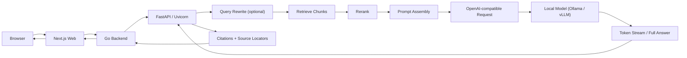

# 单智能体 V1 请求链路与 Prompt 生命周期

## 文档控制

- 状态：活动草案
- 版本：`v1.0`
- 目标：说明从浏览器发起提问到本地模型接收最终 prompt 的整条链路，并作为后续实现同步更新的依据

## 1. 目的

本文件回答两个问题：

1. 用户问题从 `Browser -> Next.js -> Go -> FastAPI/Uvicorn -> 本地模型` 具体经过哪些处理
2. 最终送到模型的 prompt 是如何逐步形成的

本文件是模块开发与联调时的参考基线。后续如果实现改变了链路、字段或 prompt 组装方式，应同步更新本文件。

## 2. 什么属于 Prompt Engineering

严格说，以下部分属于 `prompt engineering`：

- system prompt 设计
- 回答规则与拒答规则设计
- 引用输出规则设计
- 检索上下文如何拼接进 prompt
- 多轮历史消息如何裁剪后放入 prompt
- 如果使用模型做 query rewrite，那么 rewrite prompt 也属于 prompt engineering

以下部分不直接属于 prompt engineering，但会强烈影响最终 prompt 质量：

- 文档解析
- chunk 切分
- retrieval
- reranking
- source locator 结构设计
- token 裁剪与上下文预算

可以把它理解为：

- `prompt engineering` 负责“最终怎么对模型说”
- `retrieval / reranking / chunking` 负责“最终有哪些证据可以拿去说”

## 3. 总体请求链路



## 4. 分层职责

### 4.1 Browser

- 收集用户输入
- 展示流式回答
- 展示 citations 与 source locator

### 4.2 Next.js Web

- 调用后端聊天 API
- 管理会话列表、消息列表与前端状态
- 渲染 token stream 或完整回答

### 4.3 Go Backend

- 校验登录态
- 解析 `conversation_id`
- 读取该会话绑定的快照
- 将产品请求转换为 runtime 可执行请求
- 持久化消息、日志与审计记录

### 4.4 FastAPI / Uvicorn

- 接收 runtime 请求
- 执行 query rewrite、retrieval、reranking、prompt assembly
- 调用本地模型服务
- 规范化回答与 citations

### 4.5 Local Model

- 接收 OpenAI-compatible chat request
- 输出 token stream 或完整回答

## 5. 会话快照如何影响 Prompt

用户问题不会被直接原样发给模型。后端会先把问题绑定到会话快照。

当前设计里，快照至少包括：

- `conversation_id`
- `config_version`
- `retrieval_config_version`
- `knowledge_snapshot_id`
- `model_id`

这些字段决定了：

- 使用哪个 system prompt 版本
- 使用哪个 retrieval 参数集
- 使用哪个知识库可见快照
- 使用哪个具体模型

所以模型面对的不是“一个孤立问题”，而是“一个绑定了配置和知识上下文的问题”。

### 5.1 本地模型的配置权威与默认值

`model_id` 的唯一业务权威仍是 Backend 的 Agent Config：创建会话时写入会话快照，之后的请求把同一值传给 Runtime。Runtime 不保存第二份“当前业务模型”状态，只根据请求中的 `model_id` 调用已显式选择的 provider adapter。

新建本地开发环境的初始 Agent Config 由 `LOCAL_LLM_DEFAULT_MODEL_ID` 提供；本仓库默认值为 `llama3.2:latest`，与当前开发机已安装的 Ollama 模型一致。该变量只影响尚未初始化的 memory/Postgres repository，不能覆盖已有配置或既有会话快照。需要切换已有环境时，管理员应通过 Agent Config 新建配置版本。

模型服务连接由 Runtime 进程的下列变量控制：

- `LOCAL_LLM_BASE_URL`：Ollama 或其他 OpenAI-compatible 服务的 `/v1` 根地址。
- `LOCAL_LLM_API_KEY`：服务需要的 API key；本机 Ollama 可使用占位值 `ollama`。
- `LOCAL_LLM_PROVIDER`：`openai_compatible` 或 `ollama_native`。后者只为显式本机 Ollama 使用 `/api/chat`，能将 Qwen3 的 `think=false` 作为真实 provider 请求参数；thinking 内容永远不进入答案或引用解析。

因此，模型切换的回滚路径是创建或恢复一个 Agent Config 版本，不是修改 Runtime 的全局环境变量；连接地址切换的回滚路径是重启 Runtime 并恢复先前环境变量。未配置 endpoint 或模型不可用时请求 fail-closed，不存在隐式生成 fallback。

## 6. Prompt 生命周期

### 6.1 原始用户问题

浏览器输入：

```text
差旅报销需要几天内提交？
```

这时只有自然语言问题本身，还没有系统规则、证据块和引用要求。

### 6.2 后端补充执行上下文

后端不会直接改写问题文本，但会为 runtime 附带执行上下文，例如：

- `conversation_id`
- `message_id`
- `knowledge_snapshot_id`
- `config_version`
- `retrieval_config_version`
- `model_id`
- `stream`
- `response_overrides.temperature`
- `response_overrides.system_prompt_version`
- `response_overrides.response_style`
- `response_overrides.top_p`
- `response_overrides.max_output_tokens`
- `response_overrides.top_k`
- `response_overrides.rerank_enabled`

其中 `response_overrides` 必须由 Backend 按 conversation 的 `config_version` 回读，而不是读取当前活跃配置。这样该请求固定“本次回答应该遵循哪套模型、生成参数与知识状态”。

### 6.2.1 Prompt 版本不可变

`prompt_v1` 与 `prompt_v2` 保持历史内容不变。质量改进必须通过新建版本实现，不能在同一 version id 下改写模板。Backend 只允许保存已登记版本，Runtime 根据同一版本选择 bundled prompt；eval request/report 也必须显式记录版本。这样旧 conversation、execution evidence 与评测报告都能说明当时真正使用的模板，回滚只需创建/选择旧版本配置。

`prompt_v3` 的引入前提是先用非 Q1 的真实 remote probe 证明：正常有依据回答能输出只引用检索 rank 的有效 marker；范围明确而证据不足时，Runtime 在完成 scoped retrieval 后输出 `insufficient_evidence`，不附 citation 或 anchor。缺 marker 必须继续是 execution failure，不能由 Runtime、Backend 或 Web 补造 citation。`2026-07-27` probe 已证明该协议，但其中一题遗漏同一 evidence 中的默认规则，grounded correctness 为 `.8333`，故不能进入 Q1。后续改进创建了 `prompt_v4`，不得原地改写 `prompt_v3`；v4 的真实 probe 又证明当前 `llama3.2:latest` 无法稳定输出 marker，且会把明确 evidence 误判为不足。下一次候选必须采用更强的本地 instruct model、新 prompt version、新 Agent Config 与新 Q1 conditions；不得重用 v3/v4 reports。

K7 gate 通过后，新 repository 的初始配置使用 `prompt_v2`；已有 Postgres 记录不回填，现有会话仍使用创建时绑定的 prompt version。

### 6.3 Query Rewrite

runtime 可选地对问题做 rewrite。

目的通常包括：

- 把口语表达改成更适合检索的查询
- 补全文档术语
- 消除代词或上下文歧义

当上一条 assistant message 是仍然 `pending` 的结构化澄清时，普通 query rewrite 不足以承担状态判断。Backend 必须把权威 clarification context 传给 Runtime；Runtime 先判断 follow-up 是 `resolved`、`needs_more` 还是 `abandoned`，仅在 resolved 时生成并记录 `resolved_query`。retrieval 使用该 query，但原始 user message 永不改写。该行为随不可变 `answer_policy_version` 固化并进入 execution/eval evidence。

如果 rewrite 使用模型或模板，它本身也是 prompt engineering 的一部分。

### 6.4 Retrieval

runtime 使用 rewrite 后的查询检索候选 chunk。

候选 chunk 不只是文本，还应携带结构化元数据，例如：

- `file_id`
- `source_format`
- `heading_path`
- `page_no`
- `source_locator`
- `text`

### 6.5 Reranking

retrieval 返回的候选结果不会全部直接进入最终 prompt。

runtime 会先进行 rerank，以便：

- 提高最相关证据排位
- 去掉弱相关噪音块
- 控制进入 prompt 的上下文数量

### 6.6 Context Packing

rerank 后的结果需要进一步整理成真正可喂给模型的上下文。

这里通常会做：

- 保留最相关 chunk
- 按 token 预算裁剪
- 合并或去重相近内容
- 保留 citation 所需的 source locator
- 对表格、列表或 slide 内容做适合阅读的文本化

### 6.7 Prompt Assembly

这是最终 prompt 真正成型的地方。

理论上会拼出以下部分：

1. system prompt
2. 回答规则
3. 拒答规则
4. citation 输出规则
5. 检索上下文块
6. 当前用户问题
7. 可选的少量对话历史

### 6.8 OpenAI-compatible Chat Request

prompt assembly 完成后，runtime 会把它映射到 OpenAI-compatible 的 `messages` 结构。

典型形态是：

- `system`
- `user`
- 可选 `assistant` / 历史消息

因此本地模型收到的通常不是单条字符串，而是一组 chat messages。

### 6.9 当前 P5 基线实现约定

为尽快把 `P2` 的 placeholder chat route 升级成可测试的最小 RAG 闭环，当前实现阶段先固定以下基线：

- retrieval 先使用 runtime 进程内的内存索引，不要求首版就接入外部向量库
- embedding 先使用可重复的轻量词法向量化基线，便于本地测试和 refusal 阈值调优
- 检索语料先来自 `data/sample-docs/` 的真实样例资产，作为 runtime baseline corpus
- system prompt 与 refusal 模板放在 `packages/prompts/` 做版本化管理
- 回答生成走已显式配置的 `openai_compatible` 或 `ollama_native` adapter；未配置 `LOCAL_LLM_BASE_URL`、provider 非法或端点不可用时返回明确、可重试错误，不生成替代回答
- 新环境的默认 Agent Config 使用 `LOCAL_LLM_DEFAULT_MODEL_ID`，当前开发默认是 `llama3.2:latest`；具体请求仍以会话快照中的 `model_id` 为准

这意味着：

- `P5` 的第一目标是“回答链路真实存在且可验证”；测试确定性由显式 test-only provider 提供
- 不以首版就引入生产级向量库、复杂 rerank 或流式 token 为门槛
- 后续切换到 `Ollama` 或 `vLLM` 时，上层 pipeline 不应改写

## 7. 模型最终可能接收到的 Prompt 结构

下面是示意，不代表当前仓库已冻结的最终模板：

```text
[System]
你是企业内部知识问答助手。
只能基于提供的上下文回答。
如果证据不足，明确拒答。
回答时尽量给出引用。

[Answer Rules]
- 优先基于证据作答
- 不要编造
- 尽量保持简洁
- 引用必须保留 source locator

[Retrieved Context]
[1] file=employee-handbook.md
locator=heading:Expense Reimbursement
text=Travel reimbursements must be filed within 10 calendar days...

[2] file=sample-policy.pdf
locator=page:1
text=Expense claims should be submitted within 10 calendar days...

[User Question]
差旅报销需要几天内提交？
```

## 8. 与实现同步更新的要求

以下任一变化发生时，应同步更新本文件：

- 聊天请求结构变化
- 会话快照字段变化
- query rewrite 策略变化
- retrieval / rerank / context packing 顺序变化
- prompt 模板结构变化
- citation 输出规则变化
- 本地模型调用协议变化

建议更新责任：

- 改 runtime 链路的人更新本文件
- 改后端请求转换的人同步检查本文件
- 改 prompt 模板的人同步检查本文件

## 9. 当前已知差异

当前设计文档建议内部聊天端点命名为：

- `POST /v1/chat/run`

而当前占位实现使用：

- `POST /v1/chat/respond`

在正式冻结 runtime 契约时，应统一端点命名，并回写本文档。
