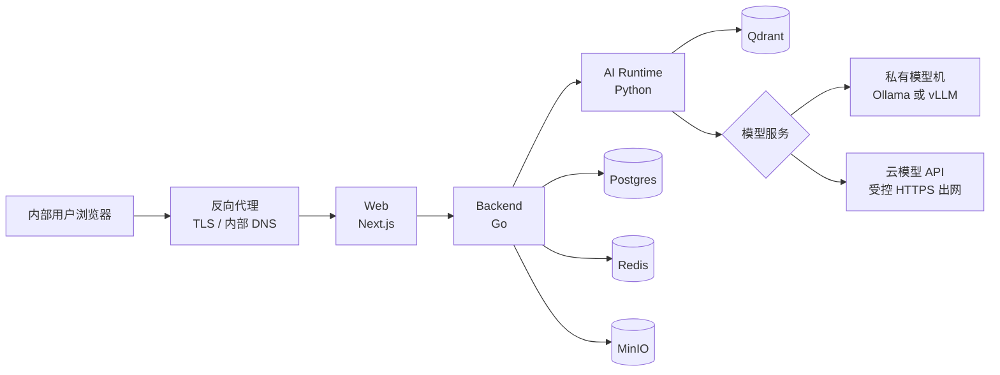

# Docker Compose 生产部署 Runbook（目标契约）

## 状态与边界

- 状态：`planned / not yet executable`
- 更新日期：`2026-07-19`
- 适用对象：单租户、私有网络内的 see-agent 内部试用与首个正式环境
- 不适用对象：公网多租户 SaaS、跨区域高可用、自动扩缩的 Kubernetes 集群

本文冻结后续 Docker Compose 生产部署的拓扑、写入边界、安全升级与回滚要求。它**不是当前可直接执行的安装说明**：仓库当前的 [`infra/compose/docker-compose.yml`](../../infra/compose/docker-compose.yml) 只包含开发/联调的 Postgres、Redis、MinIO 和 Qdrant；Web、Backend、Runtime、反向代理及 production Compose/Dockerfile 尚未实现。

实现前必须保留本 Runbook 的“单一 migration writer、私网数据服务、不可变镜像、备份先于升级”约束，不能把开发 Compose 的默认密码、宿主机端口暴露或 `latest` 标签搬进生产。

## 1. 推荐部署形态

首个正式环境采用两台逻辑主机；资源有限时可暂时合并为一台 Linux 服务器，但模型服务仍保持独立容器/进程和独立升级节奏。

### 1.1 对外与内部端口

| 服务 | 是否允许对用户网络暴露 | 说明 |
| --- | --- | --- |
| 反向代理 | 是，仅 `443` | TLS 终止、内部 DNS、请求大小/速率限制与 access log 入口。 |
| Web | 否 | 仅反向代理可访问。 |
| Backend / Runtime | 否 | 仅 Compose 内部网络可访问。 |
| Postgres / Redis / MinIO / Qdrant | 否 | 不映射宿主机公网端口；运维访问经私网、跳板机或短期本地 tunnel。 |
| 私有模型服务 | 否 | 仅 Runtime 到模型机的私网路径；不允许浏览器直连。 |

### 1.2 容器职责

- `web`：仅提供 Next.js UI 和同源 proxy；无数据库凭据、无模型 API key。
- `backend`：唯一的产品 API、鉴权、会话、配置、知识 lifecycle、Q1 与 migration 调度入口。
- `runtime`：只处理受 Backend 请求的解析、投影、检索和模型调用；不得自行写 Postgres 权威业务状态。
- `postgres`：知识 revision/snapshot、会话、配置、评测与审计的权威持久化。
- `redis`：session、Streams/队列、短期协调状态；不是知识或审计的权威存储。
- `minio`：原始上传文件与可恢复对象。
- `qdrant`：可由 immutable revision 重新投影的检索索引；不替代 Postgres provenance。

## 2. 模型服务策略

模型服务是独立故障域，不能和 Web/Backend/Runtime 共用同一个应用镜像。

| Profile | 生成模型 | Embedding | 数据出境 | 推荐场景 |
| --- | --- | --- | --- | --- |
| `private` | 私有 GPU 的 Ollama/vLLM | 私有 | 无 | 高敏感内部知识。 |
| `hybrid` | 云模型 API | 私有 | 问题与检索出的上下文片段会出境 | 已有供应商协议、需要快速取得较强生成质量。 |
| `cloud` | 云模型 API | 云 embedding API | 文件切片/问题/向量请求按供应商范围出境 | 非敏感知识，且已明确批准数据处理范围。 |

默认推荐 `private`；如需较快试用且业务批准出境，则选 `hybrid`。无论 profile 如何，Postgres、MinIO、Qdrant 都保持私有。系统管理员不能在产品 UI 任意输入云 endpoint：生产实现必须提供 provider allowlist、secret reference、出境审计标记和运行时 timeout/限额。

Ollama 可以作为 Linux GPU 容器服务部署，但需要宿主机 GPU runtime 正确配置；Docker 官方 Compose 也支持显式 GPU 分配。参考：[Ollama Docker](https://docs.ollama.com/docker)。

## 3. 将要落地的 Compose 资产

| 文件 | 责任 | 状态 |
| --- | --- | --- |
| `infra/compose/docker-compose.yml` | 当前开发依赖 | 已存在；禁止直接用于生产。 |
| `infra/compose/compose.production.yml` | production 服务、私网网络、健康检查、资源限制 | 待实现。 |
| `infra/compose/.env.production.example` | 仅非敏感配置模板 | 待实现。 |
| `services/*/Dockerfile`、`apps/web/Dockerfile` | 可重复、不可变应用镜像 | 待实现。 |
| `infra/compose/Caddyfile` 或 Nginx 配置 | TLS、内部路由与安全响应头 | 待实现。 |
| `scripts/ops/production-preflight.*` | 检查镜像 digest、secrets、依赖健康、备份和 migration 状态 | 待实现。 |

生产镜像必须使用私有 registry 的 release tag 和不可变 digest。应用服务不挂载源码；配置通过非敏感 env 与受限 secret 文件注入。Docker Compose 的 secrets 应按服务最小授权挂载，而不是把 API key、数据库密码写进镜像或提交 `.env`。[Docker Compose secrets](https://docs.docker.com/compose/how-tos/use-secrets/)

## 4. 持久化、备份与恢复

| 数据 | 权威性 | 保存方式 | 最低备份要求 |
| --- | --- | --- | --- |
| Postgres | 权威 | 独立持久卷或企业 DB | 每日逻辑备份 + 升级前即时备份 + 定期恢复演练。 |
| MinIO | 原始文件权威 | 持久卷/对象存储 | bucket versioning 或快照；与 Postgres 备份记录相同恢复点。 |
| Qdrant | 可重建索引 | 持久卷 | 定期 snapshot；灾难时可由 Postgres revision + MinIO 原文件重投影。 |
| Redis | 非权威协调态 | 持久卷（AOF） | 可丢失但要有 session/队列恢复策略；不能作为唯一证据。 |

恢复顺序：先恢复 Postgres 与 MinIO，再恢复/重建 Qdrant，最后启动 Redis 和应用。不得从 Qdrant 反推知识生命周期或 historical provenance。

## 5. 安全升级与回滚

### 5.1 唯一 migration 写入者

每次 release 只允许一个短生命周期 `migration` job 执行 Postgres migration；`web`、`backend`、`runtime` 不能并发竞争 schema 写入。migration 必须前向兼容：先扩展 schema/代码兼容层，稳定后才删除旧字段。

### 5.2 发布顺序

1. CI 构建 Web、Backend、Runtime 镜像，生成 SBOM/漏洞扫描结果，并推送私有 registry。
2. 在 staging 用固定 digest 完成 `make integration`、真实依赖 smoke、管理员登录、聊天、上传、SSE 与 Q1/knowledge fixture 检查。
3. 生产升级前确认：Postgres/MinIO/Qdrant 备份成功、当前 release digest 已记录、无未处理 migration、active snapshot 可用。
4. 执行唯一 migration job；失败即停止，应用镜像不更新。
5. 依序更新 Runtime → Backend → Web；每一步等待 readiness，再执行低风险 smoke。
6. 观察错误率、队列积压、模型超时、SSE 断流和 Qdrant/PG 连接池；通过观察窗口后标记 release 成功。

### 5.3 回滚语义

- 应用问题：回退 Web/Backend/Runtime 到上一个已验证 digest。
- migration 问题：停止发布；只使用事先验证的前向修复 migration。不能假设回滚镜像会回滚数据。
- 模型/provider 问题：通过现有 immutable config/Q1 release 回滚到前一个发布配置；不改写历史回答。
- 数据灾难：按第 4 节恢复，不用 `docker compose down -v` 作为恢复手段。

Docker 官方建议生产 Compose 使用独立 production 文件、重启策略、健康检查和镜像重建/容器重建流程；本项目会在实现时遵循这一形态。[Compose production guidance](https://docs.docker.com/compose/how-tos/production/)

## 6. 生产安全基线

- 移除 `admin/admin123`、`knowledge_admin/knowledge_admin123`、`user/user123` 和所有开发默认密码；首次部署必须通过 secret provisioning 创建系统管理员。
- 反向代理强制 TLS、HSTS、受控 CORS、合理请求体上限和速率限制；仅信任明确代理地址转发的 header。
- 模型 API key、数据库密码、对象存储密钥、session signing key 仅以 secret 文件/企业 Secret Manager 注入；日志不得打印。
- 云模型 profile 仅允许 HTTPS provider allowlist，禁止 Runtime 到任意 URL、私有 IP 或 localhost 的可配置 SSRF 路径；出网通过 egress allowlist。
- 每个容器以非 root 用户运行（必须时的存储初始化使用受控 init step）；应用镜像不含开发工具、源码或 `.env`。
- 依赖镜像和应用镜像固定 digest，并在升级前审阅变更；Docker 也建议将远程引用固定为 digest，避免 mutable tag 被无声替换。[Compose trust model](https://docs.docker.com/compose/trust-model/)

## 7. 上线前验收门

以下项目全部通过才可以把状态改为 `executable`：

1. production Dockerfile/Compose/反向代理已落地，且 `docker compose config` 可解析。
2. secrets 不在 Git、镜像、普通 `.env` 或日志中；默认账号已禁用。
3. 内网端口扫描证明仅 `443` 对用户网络可达。
4. migration 并发保护、backup、restore 和 Qdrant rebuild drill 均有自动化或记录证据。
5. private/hybrid/cloud profile 均有明确出境与 failure 行为；未批准的云 provider 请求 fail closed。
6. 升级、应用回滚、模型配置回滚和依赖故障演练通过。
7. 真实业务 onboarding、Q1（如检索/模型变更）、内部试用质量门以及 D6 可靠性门通过。

## 8. 后续实现顺序

1. 冻结生产环境变量和 secret contract；补应用 Dockerfile。
2. 实现 production Compose、Caddy/Nginx、健康/readiness endpoint 和 resource limits。
3. 实现 migration job、preflight、release digest manifest、backup/restore/rebuild scripts。
4. 在 staging 执行 private profile，完成真实业务 onboarding。
5. 选择是否额外实现 hybrid/cloud profile；这必须经过数据出境批准。

## 参考

- [Docker Compose production](https://docs.docker.com/compose/how-tos/production/)
- [Docker Compose secrets](https://docs.docker.com/compose/how-tos/use-secrets/)
- [Docker Compose trust model](https://docs.docker.com/compose/trust-model/)
- [Ollama Docker deployment](https://docs.ollama.com/docker)
- [Kubernetes readiness/liveness/startup probes（未来迁移 K8s 时）](https://kubernetes.io/docs/tasks/configure-pod-container/configure-liveness-readiness-probes/)
